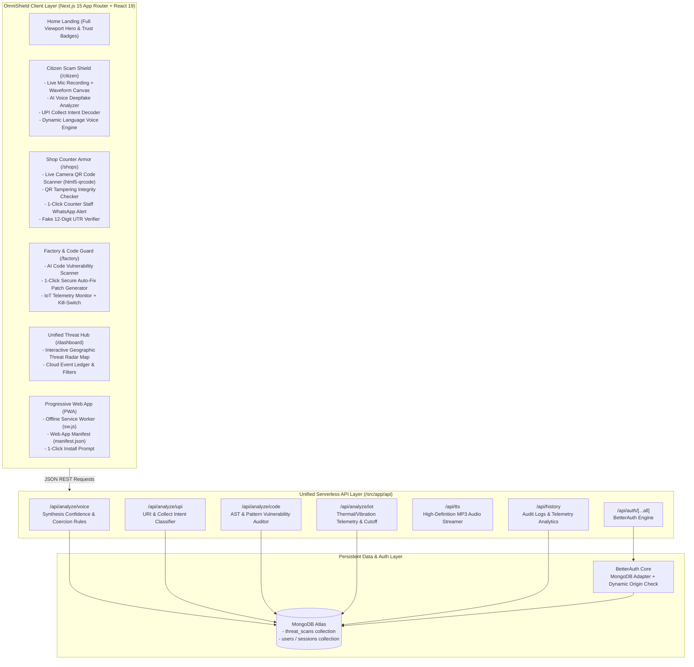

# OmniShield AI — AI Agent & Developer Architecture Guide (AGENT.md)

> **Context**: This document serves as the primary system specification, technical manual, and operational directive for AI coding agents (such as Antigravity, Cursor, Claude Code, GitHub Copilot, and SWE agents) working on the **OmniShield AI** codebase. Read this file completely before planning or making any changes.

---

## 1. Project Overview & Philosophy

**OmniShield AI** (developed by **Team VenoX**) is an autonomous, full-stack, enterprise-grade cyber safety intelligence platform engineered specifically for **everyday frontline environments**: ordinary citizens, rural families, busy retail shopkeepers, chaiwalas, and manufacturing plant operators.

### Core Problems Addressed
1. **AI Voice Clone Extortion**: Severe rise in 3-second voice-cloned distress calls (*"Papa, accident hua hai / hospital mein hoon, bhej do ₹50,000"*) and fake police/CBI "digital arrest" extortion.
2. **UPI "Collect Request" Reverse-Debit Traps**: Fraudsters sending deceptive UPI collect requests disguised as cashback or lottery approvals, scamming victims into entering their PIN to "receive" money.
3. **Physical Counter QR Code Tampering**: Malicious fraudsters pasting fake QR stickers or rogue redirector shorteners (`bit.ly`, `.apk`) over genuine merchant standees, and using fake payment screenshot apps (e.g. Paytm Spoof).
4. **AI-Written Code & Factory IoT Sabotage**: Startups deploying AI-generated code with hardcoded credentials and SQLi vulnerabilities, and small factories exposing unauthenticated IoT telemetry to sensor spoofing and physical sabotage.
5. **Language & Actionability Barrier**: Frontline victims cannot parse complex English cybersecurity manuals under panic. OmniShield AI speaks out loud in regional languages (**Hindi, Bengali, and English**) within **10 seconds**.

### Key Design Tenets for AI Agents
- **Zero Jargon / User-First UX**: Never surface developer tech stack names (like *MongoDB, BetterAuth, Next.js, Vercel, NLP, Static Analysis*) on user-facing UI screens. Use domain-specific cybersecurity product terminology (*Live Threat Telemetry, Instant Security Audit, Verified Cloud Logs*).
- **Zero Credential / PIN Logging**: Client-side privacy is sacred. The platform must never persist user banking passwords, credit cards, or UPI PINs.
- **Immediate Audible Delivery**: Every threat verdict must provide an audible spoken warning in **Hindi (`hi`)**, **Bengali (`bn`)**, and **English (`en`)** through the dedicated `/api/tts` audio streaming engine.
- **Official Forensic Actionability**: When an incident is intercepted, provide a 1-click cryptographically referenced **Cybercrime Incident Dossier (PDF)** ready for immediate submission to the National Cybercrime Helpline **1930** and `cybercrime.gov.in`.

---

## 2. High-Level System Architecture



---

## 3. Technology Stack Matrix

| Layer | Component | Version | Purpose / Responsibilities |
| :--- | :--- | :--- | :--- |
| **Framework** | Next.js App Router | `15.1.7` (Turbopack/Webpack) | Single unified full-stack monorepo hosting both SSR UI and serverless backend API |
| **Runtime & UI** | React / React DOM | `19.0.0` | Client component interactivity, reactive state management |
| **Language** | TypeScript | `5.7.3` | End-to-end type safety across client interfaces and server route handlers |
| **Styling** | Tailwind CSS | `3.4.17` | Utility-first cyber-grid theme, glowing neon accents (`#00F5FF`, `#06B6D4`, `#6366F1`) |
| **Animations** | `tailwindcss-animate` | `1.0.7` | Pulsating radar rings, live node pings, smooth transitions |
| **Database** | MongoDB Atlas / driver | `6.13.0` | Persistent cloud threat telemetry ledger, scan audit logs, cached connection pool |
| **Authentication** | BetterAuth | `1.1.18` | Email/password auth, session management, dynamic trustedOrigins, 1-click demo login |
| **Camera Scanner** | `html5-qrcode` | `2.3.8` | Real-time device camera QR viewfinder with rear/environment camera preference |
| **PDF Dossier** | `jspdf` | `4.2.1` | Client-side generation of cryptographically stamped 1930 Cybercrime Incident Reports |
| **Speech & Audio** | `/api/tts` + Web Speech | Native HTML5 Audio | Serverless HD MP3 audio stream fallback to Web Speech API for Hindi, Bengali, English |
| **Microphone** | Web Audio API | `AudioContext` + `AnalyserNode` | Real-time audio waveform visualizer canvas + SpeechRecognition transcription |
| **Icons** | Lucide React | `0.475.0` | Accessible, unified iconography across all components |
| **Deployment** | Vercel Zero-Config | Standard | Single monorepo hosting both UI and serverless endpoints (`vercel.json`) |

---

## 4. Repository Layout & File Manifest

```
OmniShield-AI/
├── .env                             # Local secrets (NEVER commit to Git!)
├── .gitignore                       # Node, Next.js build, .env, and system ignores
├── AGENT.md                         # This file (AI developer and architectural specification)
├── README.md                        # Public repository showcase & setup guide
├── components.json                  # Shadcn UI configuration file
├── next-env.d.ts                    # TypeScript Next.js declarations
├── next.config.mjs                  # Next.js configuration (reactStrictMode: true)
├── package.json                     # Dependency manifest and npm scripts
├── postcss.config.mjs               # PostCSS Tailwind and Autoprefixer configuration
├── tailwind.config.ts               # Custom color palette, container widths, cyber glow
├── tsconfig.json                    # TypeScript compiler options and `@/*` path mapping
├── vercel.json                      # Vercel deployment configuration
├── public/
│   ├── icon.svg                     # High-res neon shield PWA app icon (192x192 / 512x512)
│   ├── manifest.json                # PWA Progressive Web App configuration manifest
│   └── sw.js                        # Service worker for offline caching and PWA installation
└── src/
    ├── app/
    │   ├── globals.css              # Cyber-grid background, neon glow utility classes
    │   ├── layout.tsx               # Root layout, PWA manifest link, Navbar, Footer, PWA prompt
    │   ├── not-found.tsx            # Custom 404 security route handler
    │   ├── page.tsx                 # Full viewport hero, micro-metrics, and 3-frontier cards
    │   ├── citizen/
    │   │   └── page.tsx             # Citizen Scam Shield (Voice + UPI + Mic + PDF download)
    │   ├── shops/
    │   │   └── page.tsx             # Shop Counter Armor (Camera QR + WhatsApp + Fake UTR)
    │   ├── factory/
    │   │   └── page.tsx             # Factory & Code Guard (AI Code Auditor + IoT Kill-Switch)
    │   ├── dashboard/
    │   │   └── page.tsx             # Threat Telemetry Hub + Live Geographic Radar Map
    │   ├── auth/
    │   │   ├── login/page.tsx       # Sign in with instant demo access button
    │   │   └── register/page.tsx    # Register citizen, merchant, or industrial supervisor
    │   └── api/
    │       ├── analyze/
    │       │   ├── voice/route.ts   # Synthetic probability & coercion detection engine
    │       │   ├── upi/route.ts     # Reverse-debit & collect trap intent analyzer
    │       │   ├── code/route.ts    # Secrets, SQLi, and shell execution auditor
    │       │   └── iot/route.ts     # Telemetry spike monitor & circuit cutoff logic
    │       ├── auth/[...all]/route.ts# BetterAuth handler route
    │       ├── history/route.ts     # MongoDB audit logs & aggregated telemetry stats
    │       └── tts/route.ts         # High-definition multi-language audio streaming
    ├── components/
    │   ├── ScamCallSimulator.tsx   # Realistic incoming phone call simulation & 4-second AI defense
    │   ├── OmniSoundBox.tsx         # OmniSound™ Smart Merchant Audio Soundbox (Paytm/bKash replica)
    │   ├── JudgeLiveDemoModal.tsx   # Judge & Stage Presentation Hub with instant mobile handoff QR
    │   ├── CameraQrScanner.tsx      # Live camera viewfinder & automatic QR reader
    │   ├── LiveVoiceRecorder.tsx    # Live mic recording with pulsing audio waveform canvas
    │   ├── LiveThreatMap.tsx        # Interactive Indian regional threat radar map
    │   ├── PwaInstallPrompt.tsx     # Floating 1-click PWA app installer for mobile/desktop
    │   ├── VoiceSpeakerButton.tsx   # Audio player with reactive language switching
    │   ├── Navbar.tsx               # Minimalist single-line header with session & Judge Hub button
    │   ├── Footer.tsx               # Enterprise cyber safety footer with 1930 helpline
    │   └── ui/                      # Base primitive UI components (Button, Badge, Card, etc.)
    └── lib/
        ├── soundEffects.ts          # Web Audio API ringtone, siren, chime & buzzer synthesizers
        ├── auth.ts                  # BetterAuth server configuration & MongoDB adapter
        ├── auth-client.ts           # BetterAuth client hooks (`signIn`, `signUp`, `useSession`)
        ├── db.ts                    # MongoDB MongoClient connection pool & caching
        ├── pdfReport.ts             # 1-Click Cybercrime Incident Dossier generator (jsPDF)
        ├── speech.ts                # Audio player & Web Speech fallback engine
        └── utils.ts                 # Date formatting & Tailwind `cn` class merger
```

---

## 5. Core Protection Frontiers & Technical Implementation

### 5.1 Citizen Scam Shield (`/citizen`)
- **AI Voice Clone & Deepfake Audio Analyzer** (`/api/analyze/voice`):
  - Computes synthetic artifact confidence and linguistic coercion indicators (ransom panic, medical urgency, digital arrest authority impersonation).
  - Categorizes risk (`CRITICAL: AI VOICE CLONE` vs `PROBABLY LEGITIMATE`).
- **UPI Reverse-Debit Trap Inspector** (`/api/analyze/upi`):
  - Parses `upi://pay` URI parameters (`pa`, `pn`, `am`, `tn`, `mode`).
  - Detects deception where a victim expecting to *receive* funds is tricked into approving a collect request with their PIN.
  - Highlights Golden Rule: *"You NEVER enter your UPI PIN to receive money. PIN is ONLY used to send money out."*
- **Live Microphone Recorder & Waveform Visualizer** (`LiveVoiceRecorder.tsx`):
  - Web Audio API `AudioContext` connects to `AnalyserNode` rendering live frequency gradient bars on a canvas.
  - Native `SpeechRecognition` transcribes spoken words in real time.
- **Dynamic Multi-Language Spoken Alerts** (`/api/tts` & `VoiceSpeakerButton.tsx`):
  - Speaks out loud in **Hindi**, **Bengali**, and **English**.
  - Changing the top language selector instantaneously updates on-screen text and voice audio without rescanning.
- **Live AI Scam Call Simulator** (`ScamCallSimulator.tsx`):
  - Simulates a realistic incoming mobile phone call on iOS/Android interface with dual-tone ringtone synthesizer (`playPhoneRing`).
  - Pre-loaded with frontline attack scenarios: *CBI Digital Arrest*, *AI Voice Clone Kidnap*, and *Utility Power Cut Phishing*.
  - When answered, renders dynamic speech frequency bars, types real-time transcripts, and flashes an emergency red strobe within 3.8 seconds.
  - Sounds a police alert siren (`playSirenAlert`) and speaks out loud in regional Bengali, Hindi, or English.
  - Provides a 1-click button to download the complete 1930 Cybercrime Police Dossier directly from the call screen.
- **1-Click Cybercrime Incident Dossier** (`/lib/pdfReport.ts`):
  - Generates an official PDF report with Incident Reference ID, evidence, and 1930 filing directions.

### 5.2 Shop Counter Armor (`/shops`)
- **OmniSound™ Smart Merchant Audio Box** (`OmniSoundBox.tsx`):
  - Hardware replica of ubiquitous South Asian merchant soundboxes (Paytm / bKash / PhonePe).
  - Equipped with an LCD display, speaker mesh simulation, multi-color LED status ring, and volume control.
  - Three distinct audible broadcast modes:
    1. *Fake Payment Screenshot / UTR Warning*: Sounds warning buzzer and announces out loud: *"সাবধান! এটি একটি জাল পেমেন্ট স্ক্রিনশট, শূন্য টাকা প্রাপ্ত হয়েছে!"*
    2. *Tampered QR Sticker Warning*: Sounds alert siren and announces counter sticker tampering.
    3. *Authentic Payment Confirmation*: Melodic chime followed by spoken payment credit announcement.
- **Live Counter Camera QR Scanner** (`CameraQrScanner.tsx`):
  - Uses `html5-qrcode` to access the device's rear camera with live viewfinder overlay.
  - Automatically captures counter standees and checks for URL shorteners (`bit.ly`), rogue IP redirectors, and malicious `.apk` download traps.
- **1-Click Counter Staff Emergency WhatsApp Broadcast**:
  - Formats an urgent fraud notice in Hindi, Bengali, or English.
  - 1-click clipboard copy or direct `wa.me/?text=...` trigger to warn all shop assistants in under 5 seconds.
- **Fake 12-Digit UTR Payment Verifier**:
  - Validates bank transaction sequence structure against popular spoofing apps (e.g. Paytm Spoof).

### 5.3 Judge & Stage Presentation Hub (`JudgeLiveDemoModal.tsx`)
- Accessible via the **"Judge Hub"** button in the header and landing page hero.
- Generates a dynamic QR code pointing to the live network URL for instantaneous mobile handoff to judges' phones without any installation.
- Provides 1-click stage execution triggers for all three core frontiers.

### 5.3 Factory & Code Guard (`/factory`)
- **AI Code Vulnerability Scanner** (`/api/analyze/code`):
  - Audits AI-generated code for hardcoded secrets, SQL Injection, and unsafe `os.system()` / `eval()` primitives.
  - **1-Click Automated Auto-Fix**: Automatically generates drop-in parameterized code patches.
- **Industrial IoT Sensor Telemetry & Sabotage Defense** (`/api/analyze/iot`):
  - Monitors thermal spikes, vibration anomalies, and packet flooding in real time.
  - Features an **Automated Machine Isolation Kill-Switch** to isolate compromised equipment.

### 5.4 Unified Threat Telemetry & Regional Radar (`/dashboard`)
- **Interactive Regional Threat Radar Map** (`LiveThreatMap.tsx`):
  - Visual geographic radar with rotating beam and pulsating threat nodes across Delhi NCR, Mumbai, Kolkata, Bengaluru, Guwahati, Hyderabad, and Jaipur.
  - Interactive tooltip cards displaying threat vector, risk score, intercept time, and target payload.
- **Auditable Cloud Event Ledger**:
  - Connects to MongoDB Atlas to persist verified incident logs with real-time category filtering.

---

## 6. Progressive Web App (PWA) Implementation

- **Manifest** (`public/manifest.json`): Sets `standalone` display mode, `#050814` dark background, `#06B6D4` theme color, and maskable neon icon.
- **Service Worker** (`public/sw.js`): Caches core static assets for instant load and offline resilience. API routes (`/api/*`) bypass the cache to ensure live threat intelligence.
- **Install Prompt** (`PwaInstallPrompt.tsx`): Listens to `beforeinstallprompt` and displays a floating, sleek *"📱 Install OmniShield App"* prompt on supported mobile and desktop browsers.

---

## 7. Official Cybercrime Forensic Dossier (jsPDF)

The PDF generator (`src/lib/pdfReport.ts`) creates a formal evidence document containing:
1. **Header Banner**: `OMNISHIELD AI — CYBERCRIME FORENSIC DOSSIER`.
2. **Cryptographic Reference**: Unique Incident ID (e.g. `OS-INC-M1X8B-4921`).
3. **Classification & Risk Score**: High-contrast threat verdict badge (0–100 score).
4. **Target Entity & Evidence**: Payee VPA, suspicious URL, caller transcript, or code flaw.
5. **National Emergency Directives**: Step-by-step instructions for reporting to National Helpline **1930** and `cybercrime.gov.in`.

---

## 8. API Endpoint Specifications

| Endpoint | Method | Payload / Query | Output | Description |
| :--- | :---: | :--- | :--- | :--- |
| `/api/analyze/voice` | `POST` | `{ transcript, language }` | `{ deepfakeProbability, verdict, spokenWarning, allSpokenWarnings }` | Analyzes synthetic voice coercion & returns localized warnings |
| `/api/analyze/upi` | `POST` | `{ upiString, language }` | `{ isDangerous, scamScore, spokenWarning, allSpokenWarnings, goldenRule }` | Evaluates UPI reverse-debit collect traps |
| `/api/analyze/code` | `POST` | `{ codeSnippet, filename }` | `{ vulnerabilities, riskScore, patchedCode }` | Audits AI-generated code & produces auto-fix patches |
| `/api/analyze/iot` | `POST` | `{ machineId, temperature, vibration, status }` | `{ isAnomaly, status: "ATTACK_TRIGGER_ISOLATED" }` | Monitors machine telemetry & triggers circuit isolation |
| `/api/tts` | `GET` | `?text=...&lang=bn\|hi\|en` | `Content-Type: audio/mpeg` | Generates high-definition MP3 voice alert stream |
| `/api/history` | `GET` | `?type=...` | `{ items, stats: { totalScans, ... } }` | Fetches verified threat event ledger from MongoDB |
| `/api/auth/[...all]`| `ALL` | BetterAuth standard | User session / token | Handles registration, login, and session checks |

---

## 9. Strict Invariants for AI Coding Agents

When authoring or modifying code in this repository, **STRICTLY ENFORCE** the following invariants:

### 1. Zero Jargon on User Interface
- **NEVER** display technical names (*MongoDB, Atlas, BetterAuth, Next.js, Vercel, Monorepo, React 19, NLP, Static Analysis*) on client-facing badges, cards, or buttons.
- Use customer-centric security terminology: *Live Threat Telemetry*, *Verified Cloud Logs*, *Security Audit*, *Instant Scan*.

### 2. Git & Commit Message Invariants
- **NEVER commit `.env` or `.env.local` to Git.**
- **NEVER create `.env-example` or `.env.example`** (explicit user directive).
- **NEVER use forbidden commit prefixes**: `feat:`, `style:`, or `docs:`. Use standard sentence-case descriptions (e.g., *"Implement camera QR scanner and audio visualizer"*).
- **Always run `git pull --rebase origin main`** after pushing to keep local and remote branches in sync.
- Only commit and push files located inside the `OmniShield-AI/` directory.

### 3. Build & Cache Integrity
- Before pushing changes, verify compilation using `npm run build`.
- **Warning on Concurrent Processes**: Never leave a `next dev` process running while executing `next build`, as this corrupts `.next` CSS manifests. If unstyled CSS appears, delete `.next/` and restart the dev server cleanly.

---

*OmniShield AI Architecture & Operational Specification — Team VenoX 2026*
