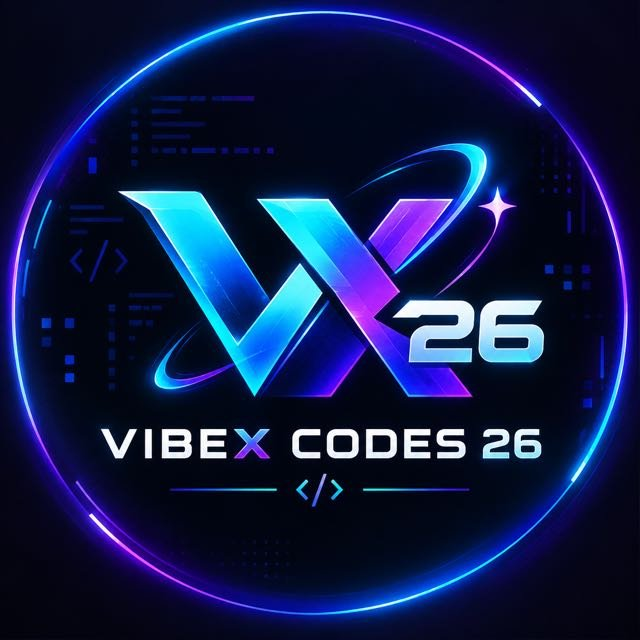
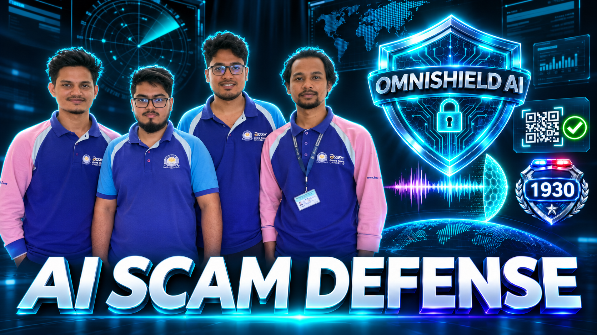
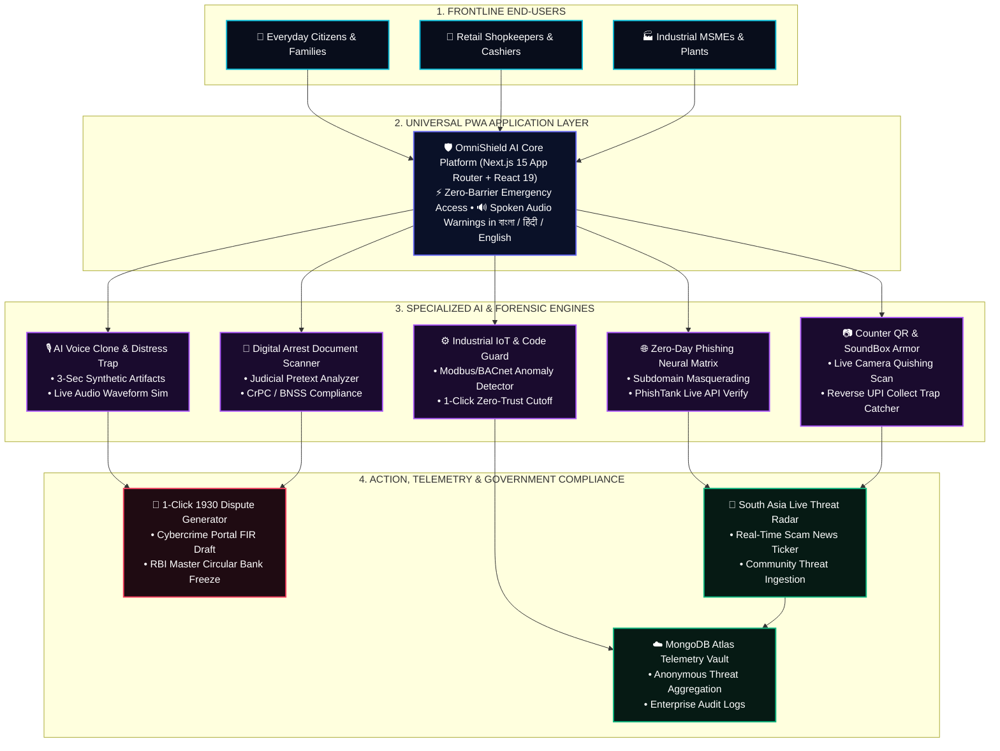

<div align="center">

# 🛡️ OmniShield AI

### Universal Cyber Safety Intelligence & Frontline Defense Platform

*Protecting Everyday Citizens, Retail Shopkeepers & Industrial Enterprises from Modern AI-Powered Frauds*

<br/>

<p align="center">
  <a href="https://omnishield-ai-eight.vercel.app/" target="_blank">
    
  </a>
  &nbsp;
  <a href="https://youtu.be/tooDqYm0g9k" target="_blank">
    
  </a>
</p>

<p align="center">
  🌐 <strong>Live Production URL:</strong> <a href="https://omnishield-ai-eight.vercel.app/" target="_blank"><strong>https://omnishield-ai-eight.vercel.app/</strong></a> &nbsp;|&nbsp; 🎥 <strong>Video Demo:</strong> <a href="https://youtu.be/tooDqYm0g9k" target="_blank"><strong>https://youtu.be/tooDqYm0g9k</strong></a>
</p>

<a href="https://omnishield-ai-eight.vercel.app/"><strong>🚀 Launch Live Platform</strong></a> •
<a href="https://youtu.be/tooDqYm0g9k"><strong>🎥 Watch Demo Video</strong></a> •
<a href="#-hackathon-organizer--track"><strong>Organizer & Track</strong></a> •
<a href="#-the-frontline-problem"><strong>Problem Solved</strong></a> •
<a href="#-system-architecture"><strong>Architecture</strong></a> •
<a href="#-flagship-modules--key-features"><strong>Live Modules</strong></a> •
<a href="#-team-venox-engineering-roster"><strong>Team VenoX</strong></a> •
<a href="#-quickstart--local-setup"><strong>Quickstart</strong></a>

<br/><br/>

[-000000?style=for-the-badge&logo=next.js)](https://nextjs.org/)
[](https://react.dev/)
[](https://www.typescriptlang.org/)
[](https://www.mongodb.com/)
[](https://better-auth.com/)
[](https://cybercrime.gov.in)
[](https://tailwindcss.com/)

</div>

---

## 🏛️ Hackathon Organizer & Track

<div align="center">
  <table border="0" style="border: none; border-collapse: collapse;">
    <tr style="border: none;">
      <td align="center" width="220" style="border: none; padding: 15px;">
        
        <br/><br/>
        <strong>Organized & Presented By</strong>
        <br/>
        <h3 style="margin: 4px 0;">VibeX Codes 26</h3>
        <em>National Innovation Hackathon</em>
      </td>
      <td width="20" style="border: none;"></td>
      <td align="left" style="border-left: 2px solid rgba(6,182,212,0.3); padding: 15px 25px;">
        <h3>🏆 Official Submission Details</h3>
        <ul>
          <li><strong>Live Production URL:</strong> <a href="https://omnishield-ai-eight.vercel.app/" target="_blank"><strong>https://omnishield-ai-eight.vercel.app/</strong></a></li>
          <li><strong>🎥 Video Demo Walkthrough:</strong> <a href="https://youtu.be/tooDqYm0g9k" target="_blank"><strong>https://youtu.be/tooDqYm0g9k</strong></a></li>
          <li><strong>Organizer:</strong> VibeX Codes 26 Committee</li>
          <li><strong>Track:</strong> <strong>Track 3 — CYBER SAFETY (Protecting People, Shops & Factories from Scams)</strong></li>
          <li><strong>Project Title:</strong> <strong>OmniShield AI</strong></li>
          <li><strong>Development Team:</strong> <strong>Team VenoX</strong></li>
          <li><strong>Core Philosophy:</strong> <strong>Zero-Barrier Emergency Defense</strong> — Instant 4-second audible spoken warnings in <strong>বাংলা, हिंदी & English</strong> without requiring prior login or IT expertise during active attacks.</li>
        </ul>
      </td>
    </tr>
  </table>
</div>

---

## 🎥 Live Video Walkthrough & Product Demo

<div align="center">

<a href="https://youtu.be/tooDqYm0g9k" target="_blank">
  
</a>

<br/><br/>

[](https://youtu.be/tooDqYm0g9k)

<br/>

**🔗 Direct YouTube Link:** [https://youtu.be/tooDqYm0g9k](https://youtu.be/tooDqYm0g9k)

*(Click on the video thumbnail above to watch the complete 2-minute walkthrough on YouTube)*

<br/>

> 💡 **What’s covered in this demo:**
> - **Citizen Scam Shield:** Live acoustic interception of 3-second AI Voice Clones and Fake "Digital Arrest" warrants.
> - **Golden Hour 1-Click Dispute Generator:** Instant drafting of formal 1930 Cybercrime Police FIRs and RBI Master Circular bank account freeze petitions.
> - **Shop Counter Armor:** Transforming any mobile phone into an AI Counter OmniSoundBox (zero hardware expense) with live camera QR tampering inspection.
> - **Factory & Code Guard:** Real-time Modbus/BACnet IoT telemetry, 1-click machine emergency kill-switch, and automated AI code security patching.
> - **South Asia Live Threat Radar:** Real-time active scam outbreak monitoring across Dhaka, Kolkata, Delhi, and Mumbai.

</div>

---

## 🚨 The Frontline Problem (Why OmniShield AI?)

Modern cybercrime across South Asia has rapidly transitioned from traditional email spam into hyper-realistic, AI-augmented extortion targeting three vulnerable sectors:

```
┌────────────────────────────────────────────────────────────────────────────────────────┐
│                                 THE ATTACK VECTORS WE SOLVE                            │
├────────────────────────────┬─────────────────────────────┬─────────────────────────────┤
│ 👥 CITIZENS & FAMILIES     │ 🏪 RETAIL MERCHANTS         │ 🏭 FACTORIES & MSMES        │
├────────────────────────────┼─────────────────────────────┼─────────────────────────────┤
│ • AI Voice Clone Kidnap    │ • Counter QR Sticker Swaps  │ • Modbus/BACnet Coil Spikes │
│ • Fake CBI 'Digital Arrest'│ • Fake Paytm/UPI Spoof Apps │ • Unvetted AI Code Flaws    │
│ • Deceptive UPI PIN Traps  │ • Spoofed Bank SMS Alerts   │ • Leaked Cloud API Keys     │
│ • Zero-Day Phishing Kits   │ • Unverified Staff Handoffs │ • Rogue Sensor Injections   │
└────────────────────────────┴─────────────────────────────┴─────────────────────────────┘
```

1. **Vulnerable Citizens & Parents**: Scammers clone children's voices in 3 seconds to extort lakhs ("Papa, police caught me for drunk driving, send ₹10 Lakhs immediately") or terrorize citizens with Skype video "Digital Arrests" using fake Supreme Court warrants.
2. **Chaiwalas & Retail Shopkeepers**: Fraudsters replace counter QR stands with malicious stickers, display fake payment screenshots on spoof apps, or send fake bank credit SMS. Shopkeepers have no time to read English security manuals while attending customers.
3. **Billions of Look-Alike Zero-Day Phishing Portals**: Scammers deploy disposable phishing domains on abuse-heavy TLDs (`.cfd`, `.rest`, `.sbs`, `.top`, `.pages.dev`) that mimic courier tracking, electricity bills, or banking portals (`allegrolokalnie.ukypteraz.rest`, `acessosicrdi.com`).
4. **Industrial Facilities & Startups**: Unpatched PLCs on factory floors and AI-generated backend software leave critical machinery and sensitive customer data exposed.

---

## 🏛️ System Architecture

OmniShield AI is architected as a **4-tier modular cyber defense grid** connecting frontline end-users directly to specialized neural inspection engines and government dispute channels:



### 📋 Architectural Layer Breakdown

| Layer | Component | Core Responsibility |
| :--- | :--- | :--- |
| **1. Presentation & Delivery** | **Next.js 15 App Router + PWA** | Zero-install emergency access across iOS, Android, and Desktop with full offline caching and regional speech synthesis. |
| **2. Acoustic & Threat Engines** | **Acoustic Neural Analyzer** | 3-second voice synthesis detection, coercive language matrix, and real-time audio playback simulation. |
| **3. Judicial & Link Forensics** | **Deep Phishing & Document Core** | Subdomain anatomy deconstruction, DGA entropy analysis, PhishTank live clearinghouse, and CrPC/BNSS fake warrant checking. |
| **4. Physical Counter Defense** | **QR Vision & OmniSoundBox** | Low-latency in-browser camera scanning (`html5-qrcode`), spoofed SMS verification, and audible merchant speaker alerts. |
| **5. Industrial Operational Security** | **IoT Sabotage Kill-Switch** | Telemetry threshold monitoring for PLC controllers and automated patch generation for AI-written code flaws. |
| **6. Legal Compliance & Action** | **Golden Hour Dispute Gateway** | Pre-formulates FIR complaints for National Cybercrime Helpline **1930** and immediate bank freeze notices under RBI Circulars. |

---

## ⚡ Flagship Modules & Key Features

### 1. 👥 Citizen Scam Shield (`/citizen`)

* **🎙️ AI Voice Clone & Distress Call Analyzer**:
  * Analyzes high-stress emergency call transcripts and audio snippets for synthetic speech artifacts and coercion cues (`Papa/Baba/Mom`, `Police/Detained/Accident`, `Urgent Cash Demand`).
  * Emits instant audible speech alerts in the victim's regional language (*"থামুন! এই কণ্ঠটি এআই দিয়ে তৈরি নকল কণ্ঠ!"*).
* **📞 Real-Time Interactive Scam Call Simulator**:
  * Live stage simulation of incoming extortion calls (CBI Digital Arrest, Son Kidnap Voice Clone, Electricity Bill Disconnection).
  * Features live synchronized caller voice audio, dynamic waveform visualizer, and an automated 4-second OmniShield interception alarm.
* **📄 Fake Digital Arrest Warrant & Police ID Forensic Scanner**:
  * First-of-its-kind judicial pretext analyzer cross-referencing documents against the Indian Code of Criminal Procedure (CrPC) and Bharatiya Nagarik Suraksha Sanhita (BNSS).
  * Immediately flags fabricated emblems, camera coercion, and reveals the legal fact: *"Digital Arrest does NOT legally exist under Indian law. Police never demand funds over WhatsApp or video calls."*
* **🚨 "Golden Hour" 1-Click Police (1930) & Bank Freeze Dispute Generator**:
  * Auto-generates legally formulated police complaints for the **National Cybercrime Portal (`cybercrime.gov.in`) / 1930 Helpline** under Section 66D of the IT Act and IPC 420.
  * Formulates formal beneficiary freeze notices for Bank Nodal Fraud Officers compliant with RBI Master Circular RBI/2017-18/15 within the critical 120-minute golden window.
* **🌐 Zero-Day Deep Phishing & Look-Alike Link Inspector**:
  * 6-layer neural matrix evaluating Subdomain Masquerading (`allegrolokalnie.ukypteraz.rest`), Combosquatting (`legal-openai.com`, `apple-ybqv.pages.dev`), Disposable High-Abuse TLDs (`.cfd`, `.rest`, `.sbs`, `.top`, `.xyz`), and PhishTank live clearinghouse database verification.
  * Strict Cryptographic Whitelist protecting legitimate global properties (`google.com`, `apple.com`, `github.com`, `gov.in`, `gov.bd`).
* **📑 Cybercrime Incident Dossier Generator (PDF)**:
  * Generates clean, sanitized PDF evidence dossiers compliant with cyber police reporting standards.

---

### 2. 🏪 Shop Counter Armor (`/shops`)

* **🔊 Counter OmniSoundBox**:
  * Turns any smartphone or connected Bluetooth counter speaker into a smart fraud detection soundbox.
  * Speaks loud transaction verification warnings in বাংলা, हिंदी, and English (*"সাবধান! এটি একটি ভুয়া পেমেন্ট রিসিট!"*).
* **📷 Vulnerable QR Code Scanner (Live Camera + Upload)**:
  * Leverages `html5-qrcode` to verify payment stand QR codes before opening shop.
  * Unmasks reverse debit traps (`upi://pay?pa=...&am=...`), rogue redirect URLs, and quishing APK download triggers.
* **💬 Fake Bank SMS & UTR Transaction Verifier**:
  * Validates 12-digit transaction sequence numbers, header structures (`VM-HDFCBK`), and balance calculations against spoof templates.
* **📲 1-Click Staff WhatsApp Emergency Broadcast**:
  * Generates instant 1-click warning alerts formatted for neighboring shopkeepers and counter employees.

---

### 3. 🏭 Factory & AI Code Guard (`/factory`)

* **⚙️ Factory IoT Telemetry Anomaly Detection & Sabotage Kill-Switch**:
  * Live monitoring of thermal, vibration, and register spikes on industrial controllers (Modbus, BACnet, MQTT).
  * 1-Click Zero-Trust Circuit Cutoff to isolate compromised machinery before physical damage occurs.
* **💻 AI Code Guard & Automated Remediation**:
  * Analyzes AI-generated backend scripts (Python, Node.js, Go) for hardcoded API keys, SQL injections, insecure deserialization, and command injection vulnerabilities.
  * Provides 1-click automated secure code patches.

---

### 4. 📡 South Asia Live Threat Radar (`/dashboard` & Homepage)

* **🚨 Breaking Threat News Ticker**:
  * Displays active zero-day scam campaigns circulating in real-time across Kolkata, Dhaka, Delhi, Mumbai, and Bengaluru (e.g., WBSEDCL power cut APKs, FedEx contraband scams, counter QR swaps).
* **👥 Community Threat Ingestion**:
  * Enables verified citizens and scouts to submit emerging scam links, numbers, and techniques directly into OmniShield's regional grid.
* **📊 Unified Telemetry Vault**:
  * MongoDB Atlas persistence tracking attack trends, scan volumes, and authenticated enterprise incident logs.

---

## 👥 Team VenoX Engineering Roster

| Member | Hackathon Role | Architectural Ownership |
| :--- | :--- | :--- |
| **MD SAMIUR RAHMAN TANIM** | Team Lead & Systems Architect | Full-Stack Architecture, Next.js 15 Integration, Serverless API Infrastructure, Production Deployment |
| **Mahidul Ahasan** | Lead Frontend & Forensic UI Engineer | **Fake Digital Arrest Warrant Scanner**, Phishing Inspector UI, Real-time Scam Call Simulator, Audio SoundBox, Master Documentation |
| **Atikur Rahman** | Backend & Compliance Engineer | **"Golden Hour" 1930 Dispute Engine**, Zero-Day Phishing Neural Matrix, Camera QR & Quishing API, Multi-lingual Voice Backend |
| **Md Amit Hasan Robi** | Threat Intelligence & Strategy Lead | **South Asia Live Threat Radar**, Attack Scenarios Dataset, Community Ingestion API, Hackathon Pitch Deck |

---

## 🛠️ Technology Stack & Standards

| Component | Technology | Purpose |
| :--- | :--- | :--- |
| **Frontend Framework** | Next.js 15.5 (App Router) + React 19 | High-performance server-rendered and client-side UI |
| **Language** | TypeScript 5.7 | End-to-end type safety |
| **Styling** | Tailwind CSS 3.4 + Radix UI Primitives | Responsive cyber-defense design system |
| **Database** | MongoDB Atlas Cloud | Scalable incident persistence & telemetry logging |
| **Authentication** | Better-Auth 1.1 | Secure session cookies & enterprise account pairing |
| **Camera Vision** | html5-qrcode | Low-latency in-browser camera QR code decoding |
| **Forensic PDF** | jsPDF | Sanitized ANSI-compliant incident dossiers |
| **Spoken Audio** | Web Speech Synthesis + Edge TTS | Multi-lingual audio warnings in বাংলা, हिंदी & English |
| **Threat Feeds** | PhishTank Live API (`checkurl.phishtank.com`) | Global community zero-day verification |

---

## 🚀 Quickstart & Local Setup

> 🌐 **Live Evaluation**: You can immediately test the live, fully-functional production app deployed on Vercel at **[https://omnishield-ai-eight.vercel.app/](https://omnishield-ai-eight.vercel.app/)** without any local setup.

### 1. Clone the Repository
```bash
git clone https://github.com/CodeWithTanim/OmniShield-AI.git
cd OmniShield-AI
```

### 2. Install Dependencies
```bash
npm install
```

### 3. Configure Environment Variables
Create a `.env` file in the root directory:
```env
# BETTER-AUTH AUTHENTICATION
BETTER_AUTH_SECRET=your_32_character_secret_key_here
BETTER_AUTH_URL=http://localhost:3000

# MONGODB ATLAS DATABASE
MONGODB_URI=your_mongodb_atlas_connection_string
MONGODB_DB=omni-shield-ai
```

### 4. Run the Development Server
```bash
npm run dev
```
Open **[http://localhost:3000](http://localhost:3000)** in your browser.

### 5. Production Build & Verification
```bash
npm run build
npm start -- -p 3000
```

---

## ⚖️ Legal & Regulatory Alignment

* **National Cybercrime Helpline**: Dial **1930** (MHA, Government of India)
* **National Cybercrime Portal**: [cybercrime.gov.in](https://cybercrime.gov.in)
* **Statutory Compliance**:
  * **Section 66D, Information Technology Act, 2000** (Cheating by personation using computer resource)
  * **Section 420 IPC / Section 318(4) Bharatiya Nyaya Sanhita (BNS)** (Cheating and dishonestly inducing delivery of property)
  * **RBI Master Direction RBI/2017-18/15** (Customer Protection — Limiting Liability of Customers in Unauthorized Electronic Banking Transactions)

---

<div align="center">
  
  &nbsp;&nbsp;&nbsp;&nbsp;
  <strong>VibeX Codes 26 National Hackathon • Team VenoX</strong>
  <br/>
  <em>Securing the digital frontiers of Citizens, Merchants & Industries.</em>
</div>
